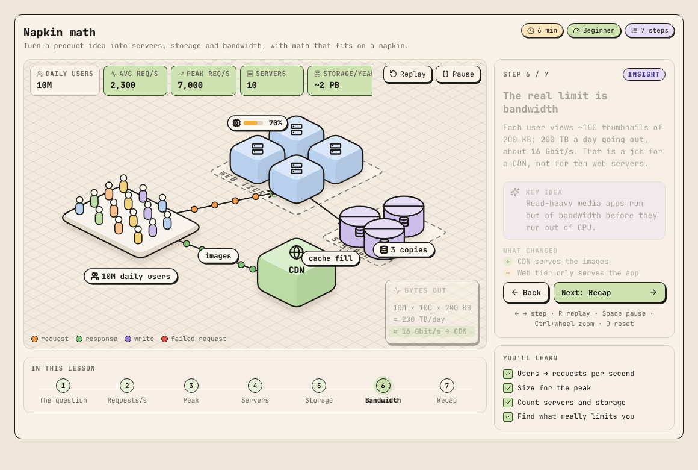

# Stepper for Obsidian



Write a small YAML block in a note. Stepper turns it into an **animated, step-by-step isometric diagram** you click through: servers, users and databases as little 3D blocks, dots flowing along arrows, and one idea per step.

````markdown
```stepper
title: Will one server do?
steps:
  - title: The question
    text: 10 million users, 20 requests a day each.
    scene:
      users: { type: crowd, at: [-6, 4], label: 10M users }
      s0:    { type: block, at: [4, -4], label: [One, "server?"] }
    links: { u: { from: users, to: s0 } }
    flows: [ { route: [u], rate: 2 } ]
```
````

- **How to write a block:** [docs/format.md](docs/format.md)
- **A full example lesson:** [examples/napkin-math.md](examples/napkin-math.md)
- **How it was built, phase by phase:** [docs/](docs/)

## Install

Stepper is not in the community store. Clone it into your vault's plugin folder, then turn it on in **Settings → Community plugins**:

```bash
cd <your vault>/.obsidian/plugins
git clone https://github.com/heshamadeldwedar/obsidian-stepper stepper
```

To update later: `cd stepper && git pull`, then reload Obsidian. The built `main.js` is committed on purpose, so you don't need Node to install it.

## Develop

```bash
npm install
npm test          # unit tests (Node's built-in test runner)
npm run build     # src/ → main.js
npm run dev       # rebuild on every save
npm run preview   # build dev/preview.html, a browser page that shows the diagram without Obsidian
npm run smoke     # build dev/smoke.html: the real main.js against a fake Obsidian, checks print on the page
```

The code is plain JavaScript. Start reading at `src/main.js`. Each file begins with a comment that says what it does.

## Features

<!-- Updated at the end of every phase. -->
### Phase 1: Skeleton
- [x] Plugin loads in Obsidian and finds ` ```stepper ` blocks
- [x] Shows the block's title
- [x] A broken block shows a readable error instead of crashing
- [x] Build (`npm run build`) and install by `git clone` / `git pull`

### Phase 2: Lesson format
- [x] Read title, metrics, legend, goals, steps
- [x] Each step starts from the previous one (scene, links, metrics)
- [x] `id: null` removes a shape, `scene!` replaces the whole scene
- [x] Flows are per step (not inherited)
- [x] Errors say where: `steps[2].scene.s0: unknown type "srvr"`
- [x] Unit tests (7)

### Phase 3: Drawing
- [x] Isometric math: floor (x, y) and height z → screen
- [x] Rounded corners everywhere (the hand-drawn look)
- [x] Shapes: `block` (3D box with icon and label), `crowd` (people on a platform), `db` (cylinder), `zone` (dashed area, name on the floor)
- [x] Colors, and `heat` turning a shape red
- [x] CPU gauge pill above a block
- [x] Dotted isometric grid that fades at the edges
- [x] Camera fits everything in view
- [x] 67 Lucide icons bundled (no runtime library)
- [x] Browser preview page (`npm run preview`)
- [x] Unit tests (7 more, 14 total)

### Phase 4: Arrows and labels
- [x] Links between shapes that stop at each shape's edge
- [x] Corners through `via` points, rounded
- [x] Arrowheads: `end`, `both`, `none`
- [x] Styles: `solid`, `dashed`, `off`, `beat` (pulsing), `cut` (red ✕)
- [x] Label pills on links, always drawn on top
- [x] Name pills under crowds and databases, tags above shapes
- [x] Unit tests (4 more, 18 total)

### Phase 5: The panel
- [x] Header: title, subtitle, pills (minutes, level, step count)
- [x] Numbers bar: values start as `?`, fill in, and flash green when they change
- [x] Step panel: "Step n / N", kind badge, title, Markdown text (links work), callout, "What changed"
- [x] Back / **Next: <next step's name>** buttons
- [x] Timeline: numbered dots you can click, done and current states
- [x] "You'll learn" goals that tick as you reach their step
- [x] The napkin card on the diagram, last line highlighted
- [x] Legend of dot kinds
- [x] Keyboard: ← → step, Space pause, R replay (only while the block has focus)
- [x] Layout follows the block's own width: one column when narrow, side panel when wide
- [x] Every button has a visible label or `aria-label`

### Phase 6: Moving dots
- [x] Dots travel along a route of one or more links, at `rate` dots per second
- [x] Dot kinds: request, response, message, write, heavy, slow, health check, poison, failure, yours
- [x] `fail`: a share of dots burst into a red ✕ on the way
- [x] `bounce`: go there and come back as a green response; `reverse`: run backwards
- [x] A small ring pops when a dot arrives
- [x] Arrows are already busy when a step appears (no empty start)
- [x] Pause and Replay
- [x] The loop stops when the block is off screen or paused (no wasted CPU)
- [x] Unit tests (5 more, 23 total) + a browser check

### Phase 7: Step change animation
- [x] Shapes are matched by id between steps
- [x] Old dots drain (finish their trip, no new ones)
- [x] Camera glides to fit the new scene
- [x] Shapes that stay slide, resize and recolor in place; words switch half way
- [x] Shapes that leave fade out; links fade in and out
- [x] New zones fade in on the floor
- [x] New shapes drop in from 120 px above, back to front, with a small bounce
- [x] New dots start after the last shape lands
- [x] Pause freezes a step change mid-way; Replay plays the change again
- [x] Unit tests (7 more, 30 total) + a filmed browser check

### Phase 8: More shapes and states
- [x] `queue`: a row of waiting items with its name on the floor
- [x] `device`: a laptop or phone on a small platform
- [x] `ghost`: a dashed see-through box (planned or removed)
- [x] `ring`: nodes on a dashed circle (consistent hashing)
- [x] States: `heat` (blue → red), `cpu` gauge, `dead` (gray, red ✕, DOWN tag), `dim`, `lift`, `tags`
- [x] Shape gallery in the preview (`?gallery=1`)

### Phase 9: Obsidian polish
- [x] Dark mode that follows Obsidian's theme
- [x] Settings: animation speed (0.5× / 1× / 2×), motion (follow system / always / reduced), show the grid
- [x] Full-screen window (button in the header)
- [x] Command: insert an example block
- [x] Command: open the block under the cursor in full screen
- [x] Remembers the current step when Obsidian redraws the block while you edit
- [x] Zoom (Ctrl/⌘ + wheel), drag to pan, double-click or `0` to reset
- [x] Reduced motion: each step as a still picture
- [x] Print / PDF export: the current step, without buttons
- [x] Smoke test of the real `main.js` against a fake Obsidian (13 checks)
- [x] Unit tests (2 more, 32 total)

### Phase 10: Example and release
- [x] Full example lesson: `examples/napkin-math.md` (7 steps, our own words)
- [x] Test that every published example (README, format guide, examples, insert command) is a valid lesson
- [x] Acceptance: Jev did all 8 actions (Next ×3, Pause, Play, timeline, Back, Replay) in 2.3 s from plain-English instructions; headless check, no errors
- [x] Performance: 3 blocks at 0.1 ms of plugin work per frame; zero work when off screen
- [x] Version 1.0.0, GitHub release with `main.js`, `manifest.json`, `styles.css`
- [x] Unit tests: 37 total

### After 1.0 (your feedback)
- [x] Inline blocks hide Replay and Pause (full screen keeps them; R and Space still work)
- [x] Blocks are wider than the note text: up to 1200px, centered (`dev/obsidian-layout.html` checks it)

## Not in v1
- A visual editor (blocks are written as YAML)
- Exporting a step as PNG, or the animation as video
- Listing in Obsidian's community plugin store

## Credits

Icons from [Lucide](https://lucide.dev) (ISC license). The look was inspired by the *Designed to Scale* course by Dilum Sanjaya. No code or artwork was copied from it.
