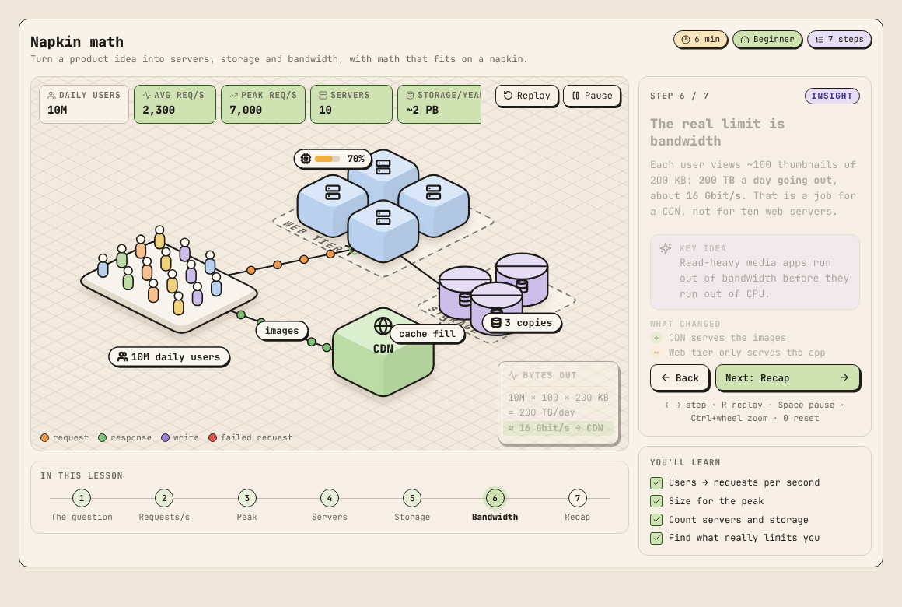

# Phase 10: Example and release

**Goal:** a full example to learn from, proof that the whole thing works, and a 1.0.0 release.

## What I did

1. **A full example lesson**, `examples/napkin-math.md`: 7 steps from "is one server enough?" to "the real limit is bandwidth", written in our own words. It uses most features: the numbers bar, cards, a zone, servers dropping in, a server heating up with failing requests, databases, a CDN with green response dots, a dashed cache-fill link, goals and a recap.
2. **Found and fixed a YAML trap.** `label: [One, server?]` is not valid YAML, because `?` means something special inside `[ ]`. It was in the README, the format guide and the insert command. Now it's quoted (`"server?"`), and the format guide warns about it.
3. **Every published example is tested.** `tests/examples.test.js` finds every `stepper` block in the README, the format guide, `examples/` and the plugin's insert command, parses it with a real YAML parser and runs it through `readLesson`. A broken example in the docs now fails the tests.
4. **Acceptance check.** **Jev** (in a real Chrome, plain-English instructions) did all 8 actions in 2.3 s. The same eight actions also run headless,, each finding its button by its accessible name like an agent would: Next ×3, Pause, Play, a timeline dot, Back, Replay. All worked, no errors. It found one small bug: after pausing, the button's tooltip still said "Pause". Fixed.
5. **Performance check.** Three blocks on one page: the plugin's work is **0.1 ms per frame** (the budget at 60 fps is about 16 ms). Scrolled off screen: **zero** animation callbacks.
6. **Release 1.0.0.** Version bumped in `manifest.json` and `package.json`, `versions.json` added (Obsidian uses it to match plugin and app versions), a GitHub release with the three files Obsidian needs.

## Tests

37 unit tests, the 13-check smoke test, the acceptance check and the performance check.
