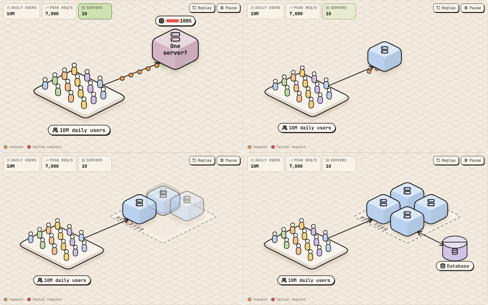

# Phase 7: The step change animation

**Goal:** when you press Next, the old picture should *turn into* the new one, so your eye can follow what changed.

## What I did

1. **Copied the timing from the reference.** I sampled the reference site's diagram every 50 ms during real step changes and wrote down when each thing happens. The result is one table, `TIMING`, at the top of `src/transition.js`:

   | When (ms after the click) | What happens |
   |---|---|
   | 0 → 500 | **Old dots drain:** they finish their trip, no new ones start |
   | 0 → 300 | Shapes that leave fade out |
   | 150 → 950 | **The camera glides** to fit the new scene |
   | 200 → 900 | **Shapes that stay change in place:** move, resize, recolor. Words (label, color, icon) switch half way |
   | 800 → 1300 | New zones and new arrows fade in |
   | 900 + 120 per shape | **New shapes drop in** from 120 px above, back to front, landing with an ~8 px bounce |
   | after the last landing | New dots start |

   Want it faster or slower? Change the numbers in that table.
2. **The animation is one pure function.** `planChange(from, to)` sorts shapes into *stays*, *leaves*, *zones* and *drops*, once. `stateAt(plan, ms)` returns exactly what to draw at any moment. No hidden state, so the tests can check "at 550 ms the server is half way and half red".
3. **The player plays it (`src/player.js`).** Each frame it asks `stateAt()` for the current picture and draws it. The stage only redraws shapes whose SVG changed, so a shape standing still costs nothing.
4. **It runs on its own clock.** Time only moves while the loop runs, so **Pause freezes a step change mid-way**, and an off-screen block picks up where it stopped.
5. **Replay** puts the previous step back and plays the change again.
6. **Reduced motion** skips all of it and jumps straight to the new step.

## Tests

`tests/transition.test.js`: the plan's sorting, "at the click nothing moved", shapes half way at 550 ms, leaving shapes gone at 300 ms, drops starting high, dipping about 8 px and settling on 0, links fading, the camera gliding, new dots waiting for the end. 30 tests in total.
Browser check: filmed a step change (picture above) and timed it: camera 150–950 ms, a new block appearing from about 1,150 ms, dots restarting at about 2,000 ms.
