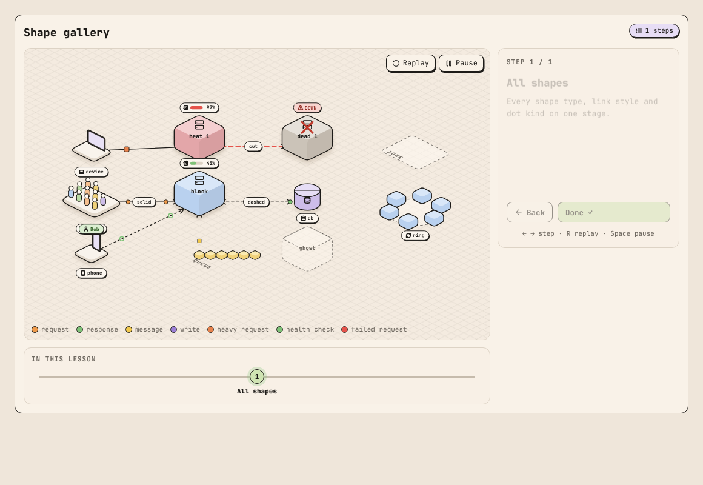

# Phase 8: More shapes and states

**Goal:** the rest of the shapes from the reference, so most system-design diagrams can be drawn.

## What I did

1. **Four more shape files**, each with the same five exports as the others (`layer`, `reach`, `bounds`, `draw`, `overlay`):
   - **`queue.js`**: a row of `n` small boxes in the direction `dir`, with its name written on the floor along the row (like "1,200 jobs waiting").
   - **`device.js`**: a small platform with a screen standing on its back edge. `kind: laptop` is wide, `kind: phone` is tall and narrow.
   - **`ghost.js`**: a dashed, see-through box, for something planned or just removed.
   - **`ring.js`**: small servers spaced evenly on a dashed circle on the floor, for consistent hashing.
2. **States, on blocks and databases:**
   - `heat` 0 → 1 mixes the colors towards red (an overloaded server).
   - `cpu` 0 → 1 shows a gauge pill above: green under 60%, amber under 85%, red above.
   - `dead` 0 → 1 fades to gray and draws a red ✕. Past half way it also adds a red **DOWN** tag.
   - `dim` fades a shape back, `lift` raises it, `tags` adds pills above.
   All of these are numbers, so phase 7's morph animates them: a server *heats up* smoothly when the step changes.
3. **Adding a shape is now a recipe:** write the file, add its defaults to `SHAPES` in `lesson.js`, list it in `shapes/index.js`. The "every shape draws" test picks it up by itself.
4. **A gallery in the preview** (`dev/preview.html?gallery=1`) shows every shape, link style and dot kind at once. The picture above is from it.

## Tests

The existing test "every shape type draws, has bounds and stays inside its layer" now covers all 8 types.
