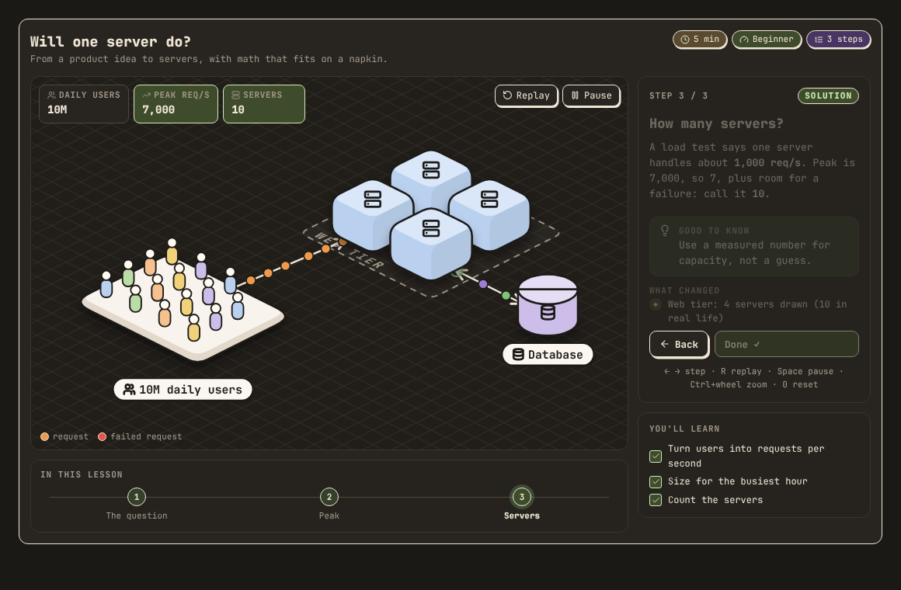

# Phase 9: Obsidian polish

**Goal:** make it feel at home in Obsidian: dark mode, settings, full screen, commands, and no surprises while editing.

## What I did

1. **Dark mode.** All colors are CSS variables at the top of `styles.css`. Under Obsidian's `.theme-dark` only the variables change. The pastel shapes keep their dark outlines (they read well on dark), while text, arrows and panels switch to light on dark.
2. **Settings tab** (Settings → Stepper):
   - **Animation speed:** 0.5×, 1×, 2×.
   - **Motion:** follow the computer's reduced-motion setting, always animate, or reduced (each step as a still picture).
   - **Show the grid.**
3. **Full screen.** A button in the block's header opens the same lesson in a big window, on the step you were on. There the layout has room for the side panel.
4. **Two commands** (Ctrl/⌘ + P):
   - *Stepper: Insert an example block*, a working two-step block to start from.
   - *Stepper: Open the block under the cursor in full screen*, which only shows up when the cursor is inside a stepper block. The code that finds the block is in `src/editor.js`, with tests.
5. **Remembers your step.** Obsidian redraws a block every time you type in the note. The plugin remembers the step per block (note path + line), so editing doesn't send you back to step 1.
6. **Zoom and pan.** Ctrl/⌘ + mouse wheel zooms (plain scrolling still scrolls the note), drag pans, and double-click or `0` resets. Changing step resets it too.
7. **Printing and PDF export** show the current step as a still picture, without buttons.
8. **Cleanup.** When a block leaves (note closed or redrawn), `onunload` stops its animation loop and its visibility watcher.

## Tests

- `tests/editor.test.js`: finding the block under the cursor (2 tests, 32 in total).
- **Smoke test** (`npm run smoke`, open `dev/smoke.html`): the real built `main.js` runs against a small fake of Obsidian's API. 13 checks, all passing: registers the block, adds the commands and settings, draws, Next, remembers the step across a redraw, full screen, settings show, both commands, error box, unload stops the loop.
